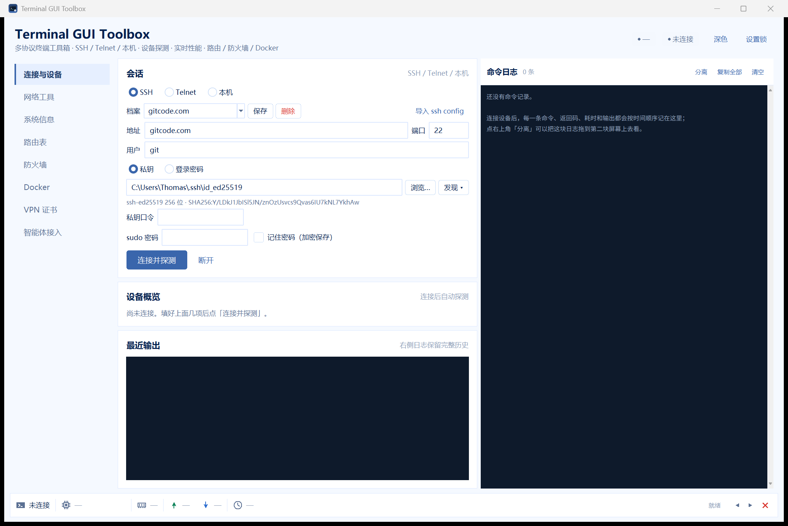
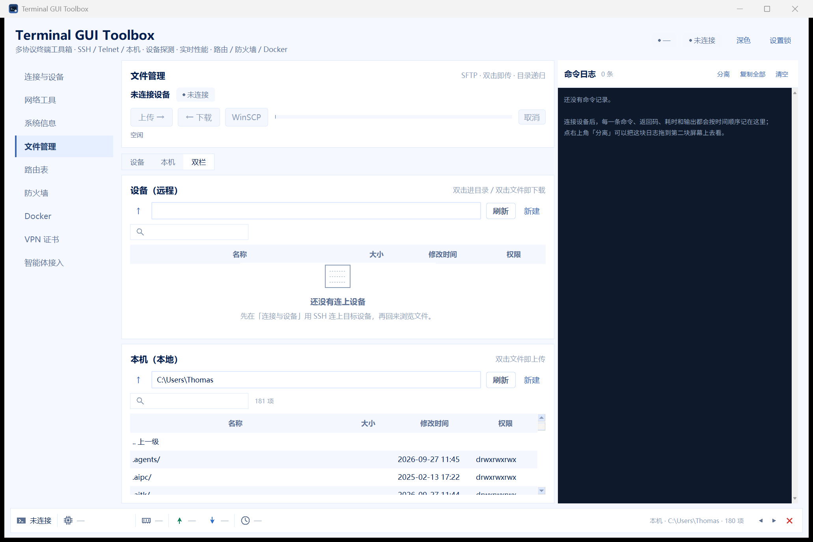
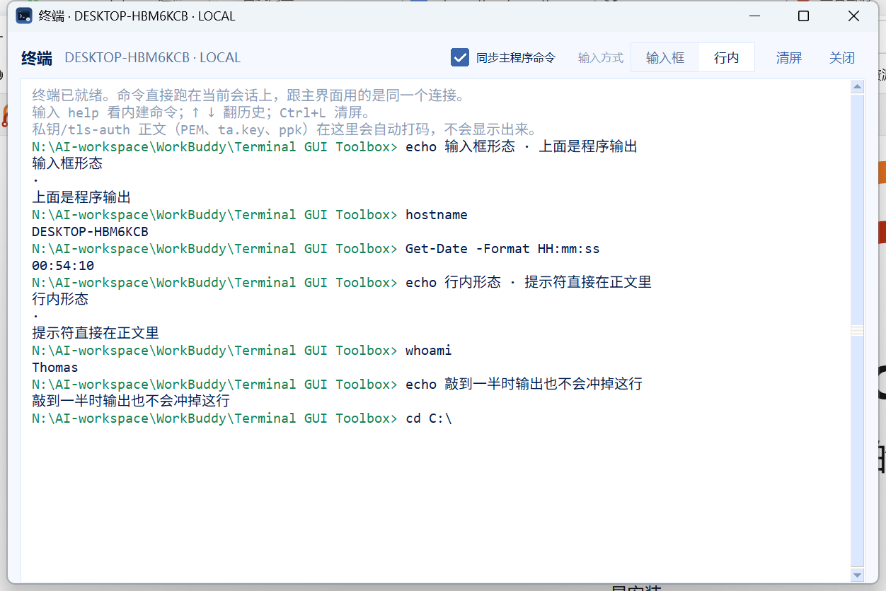
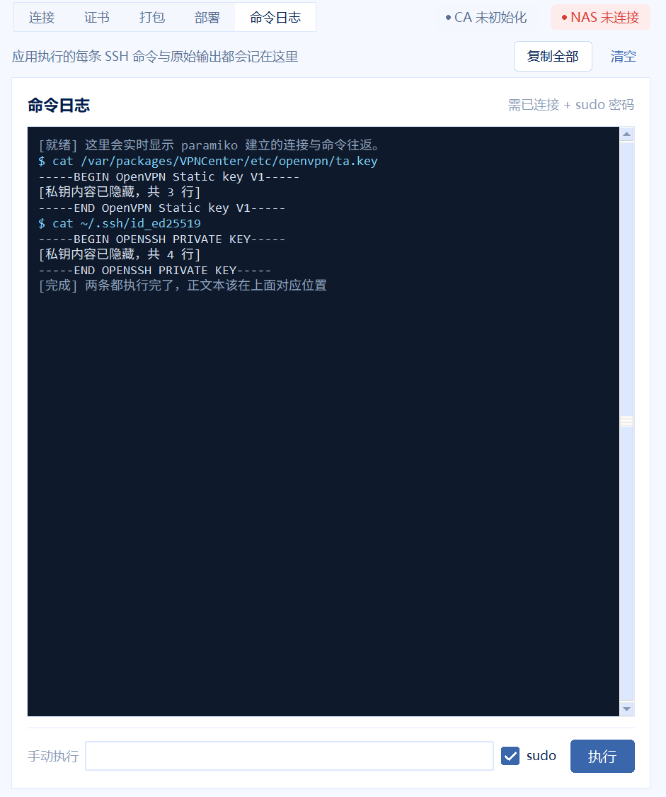
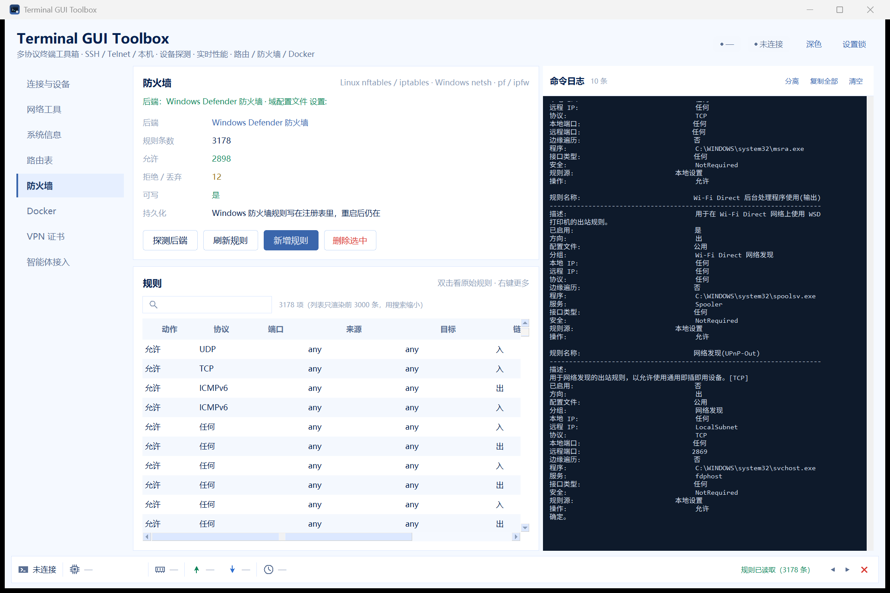
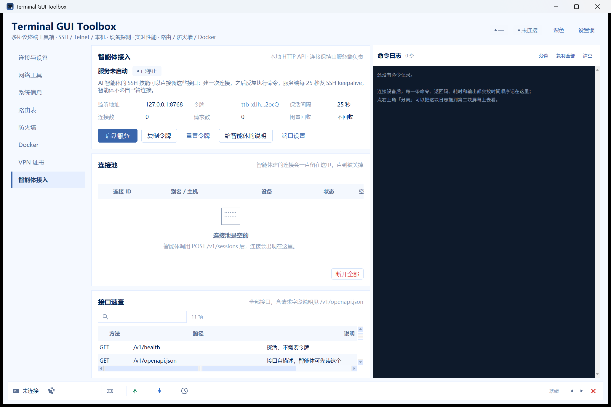

# Terminal GUI Toolbox

[](LICENSE)
[](requirements.txt)
[](#安装与启动)
[](#离线自测)

**把「连着几台机器反复敲同样几条命令」这件事做成窗口。**

多协议终端工具箱：**SSH / Telnet / 本机**三种会话，连上自动识别对方的操作系统与设备类型，
命令按系统自动换写法；底部是 MobaXterm 式的实时状态条（CPU / 内存 / 网络 / 运行时长），
右侧是可分离的命令日志，另有一个默认关着、需要时才点开的终端。
九个页面覆盖连接、网络诊断、文件传输、路由、防火墙、Docker、VPN 证书和给 AI 智能体用的本地 API。

单文件 exe，绿色免安装：不装 Python、不写注册表、不占端口、不起后台服务。
运行时只依赖两个库（paramiko、cryptography），界面全部用 tkinter 手写，不引第三方 UI 框架。

界面风格参考 WorkBuddy 的浅色蓝调（可切深色），代码与资源为独立实现。

## 为什么会有这个项目

运维日常是这样的：SSH 登上一台 NAS 看负载，再跳到路由器查路由，再回 Windows 看端口占用。
每换一台机器，就要重新回忆「这台是 busybox 还是 GNU」「ping 该 `-c 4` 还是 `-n 4`」。
MobaXterm 好用但只有 Windows 且不开源；剩下的要么只管 SSH，要么只管某一家 NAS。

这个项目把三件事拧在一起：**会话统一**（本机 / SSH / Telnet 走同一套接口）、
**命令方言**（同一个意图按系统生成正确的命令）、**结果结构化**（能把 `ip route` 解析成表格去改）。
VPN 证书控制台只是其中一个页面，不是全部——它最初是本项目的前身。

## 功能一览

| 页面 | 能做什么 | 值得说的细节 |
|---|---|---|
| **连接与设备** | SSH / Telnet / 本机；连接档案；密钥发现与指纹核对 | 选私钥即显示类型、位数、SHA256 指纹，可像 `ssh-keygen -lf` 那样核对；自动探测 DSM / OpenWrt / Linux / Windows / FreeBSD |
| **网络工具** | Ping、路由追踪、DNS、端口监听、连通性测试 | 按方言生成命令，Windows 用 `-n 4` / `tracert -d`，Linux 用 `-c 4` / `traceroute -n` |
| **系统信息** | CPU、内存、磁盘、启动时间、进程、服务 | 一次命令分段返回（`@@@` 分隔），不做多次 SSH 往返 |
| **文件管理** | 本地 / 远程双栏浏览、上传下载、队列、进度、取消 | 走 SFTP 自己实现，不依赖外部工具；检测到 WinSCP 可按当前档案一键拉起 |
| **路由表** | 读路由、加/删路由 | `ip route` / `route` / `netstat -rn` 输出统一成表格 |
| **防火墙** | 读规则、开/关端口 | 覆盖 nft、iptables、netsh advfirewall、pf、ipfw；3178 条规则也带横向滚动 |
| **Docker** | 容器/镜像列表、启停、日志 | 区分「未安装 / 守护进程没起 / 无权限 / 正常」四种状态，不把报错刷满日志 |
| **VPN 证书** | 自建 CA、签服务端与设备证书、打包 `.ovpn`、部署到 NAS | 内嵌页面，不是外挂程序；部署前自动备份，命令全可回溯 |
| **智能体接入** | 本地 HTTP API + 会话池 | 连一次反复下命令，服务端每 25 秒 SSH keepalive，掉线自动重连 |

另外三块不属于任何单页，但天天在用：

- **底部状态栏**：一格一格的设备名、CPU（带迷你曲线）、内存、↑↓ 速率、运行时长，3 秒刷新。
  图标全部 Canvas 自绘，不依赖图片资源。
- **命令日志**：右侧可拖宽、可分离成独立窗口，**分离后历史一行不丢**（内容与视图分离，
  重建视图时从 model 重放）。往上翻自动暂停滚动。
- **终端**（默认不打开）：跟主界面共用同一条连接，程序执行的命令和你手敲的命令都在里面。
  手动输入有「输入框 / 行内」两种形态，右上角切换，选过就记住。

## 界面

| 连接与设备 | 文件管理（SFTP 双栏） |
|---|---|
|  |  |

| 终端（行内模式） | VPN 证书控制台（内嵌） |
|---|---|
|  |  |

| 防火墙（横向滚动） | 智能体接入 |
|---|---|
|  |  |

全部截图在 [`screenshots/`](screenshots/)，深色主题见 `conn_dark.png`。

## 安装与启动

**方式一：下载现成的 exe**（推荐）

到 [Releases](../../releases) 下载 `TerminalToolbox.exe`，放在任意目录双击。
首次启动要解压依赖，约 3–5 秒；之后每次 2–3 秒。

**方式二：从源码跑**

```bash
pip install -r requirements.txt
python app.py            # 或双击 run.cmd
```

要求 Python 3.9+（开发与打包用的是 3.13）。除 paramiko 和 cryptography 外没有运行时依赖。

**命令行参数**

```
TerminalToolbox.exe                启动
TerminalToolbox.exe --dark         深色主题
TerminalToolbox.exe --page files   直接落到某一页
                                   （conn/tools/sys/files/routes/fw/docker/vpn/api）
```

产物直接落在项目根目录，不生成 `dist/` 子目录 —— exe 与 `data/` 必须同级，
`data` 才会跟着 exe 走。`app.py` 里的 `DATA_DIR` 做了 `sys.frozen` 判断：
onefile 模式下 `__file__` 指向 `%TEMP%\_MEIxxxx`（退出即删），
数据目录必须锚定 `sys.executable` 的父目录，否则每次启动 CA 都会「消失」。

**重新打包**：双击 `build.cmd`（等价于
`python -m PyInstaller --noconfirm --clean --distpath . toolbox.spec`）。
图标由 `_mkicon.py` 生成（蓝底 + 终端窗口 + `>` 提示符 + 齿轮，16/24px 自动简化版）。

## 四端镜像

同名仓库 `terminal-gui-toolbox` 在四个平台同步，内容一致：

| 平台 | 地址 | 说明 |
|---|---|---|
| GitHub | <https://github.com/thomachq/terminal-gui-toolbox> | 主仓库，Issues / Releases |
| Gitee | <https://gitee.com/thomachq/terminal-gui-toolbox> | 国内访问加速 |
| GitCode | <https://gitcode.com/thomachq/terminal-gui-toolbox> | 国内访问加速 |
| Forgejo（自建） | <https://chromas.synology.me:32443/thomachq/terminal-gui-toolbox> | 私有镜像，SSH 端口 2222 |

四端都只放源码与截图，exe 走 GitHub Releases。

## 安全设计

这类工具天生握着别人的服务器密码，所以边界要写清楚：

- **纯本地程序**：不开监听端口、不对局域网暴露。本地 API 默认关闭，只绑 `127.0.0.1`
- **连接档案整体加密**：`data/profiles.dat` 是密文（AES-256-GCM），明文里搜不到主机名和口令；
  只有勾了「记住密码」的字段才写入，没勾的一个字都不落盘
- **私钥正文永不进界面**：PEM、`OpenVPN Static key V1`、PuTTY `.ppk` 三类正文在
  **五个出口**统一打码成「[私钥内容已隐藏，共 N 行]」，`cat id_ed25519` 最多看到一行回执
- **应用锁**：PBKDF2-HMAC-SHA256（20 万次）校验值，不存密码；闲置超时自动重锁
- **CA 私钥不出本机**：NAS 上只放 CA 公钥证书

强度也要说实话：加密密钥与密文放在同一个 `data` 目录里，跟随文件夹一起走。
它防的是「明文被顺手看到、被搜索、被同步到网盘」，**不防拿到整个文件夹的人**。
便携与保密本来对立，这里选了便携。详见 [安全边界](#安全边界)。

`data/` 里是你的 CA 私钥、设备证书和连接档案，**已在 `.gitignore` 中排除**。
第一次运行后 `git status` 里看不到它，是故意的，不要为了「备份方便」把它提交上去。

## 技术要点

几个踩过坑才定下来的做法，写在这里免得后来人重踩：

- **命令方言层**（`core/detect.py`）：`detect(session) -> DeviceInfo` 跑最少的探针认出系统，
  `dialect_for(info) -> Dialect` 拿到该系统的命令生成器。探测失败一律回落 POSIX 方言，
  界面标注「未知系统」，不会崩。
- **编码**：Windows 子进程输出是 ANSI 码页（中文系统 cp936），直接 `decode("utf-8")`
  会把「无法访问目标主机」变成 `����`。先试 UTF-8、再试系统码页、最后才 replace。
- **跨线程**：Tk 的 `after` 不是线程安全的，后台线程的结果统一投进队列，
  由主线程 `_drain` 取出执行。
- **单文件数据目录**：见上文 `DATA_DIR` 的说明。

## 许可证

[MIT](LICENSE) © 2026 thomachq

第三方组件（paramiko、cryptography、PyInstaller、Pillow）的归属与许可证条款见
[THIRD-PARTY-NOTICES.md](THIRD-PARTY-NOTICES.md)。
简单说：paramiko 是 LGPL-2.1（本项目只调用、未修改、未静态链接，符合其第 6 条）；
PyInstaller 的 GPL 带有 bootloader 例外，打包产物不受传染。

---

# 详细文档

下面是逐页、逐模块的实现说明。想直接用的人看到这里就够了，想改代码的往下看。

## 九个页面

左侧导航切换，不换窗口。列表类页面统一是 DSM 那套观感：工具条（搜索在左、动作在右）
+ 斑马纹表格 + 空态（图标 + 一句「还没有…」+ 一句「怎么办」）+ 右键菜单。

### 1 · 连接与设备

**协议**：SSH / Telnet / 本机。选「本机」时地址与认证区自动收起，工具直接跑在本机。

**连接档案**——参考 OpenSSH 客户端的做法：

- 下拉选档案，参数一次带出；「保存」覆盖当前档案，「删除」删掉
- 「导入 ssh config」读 `~/.ssh/config` 的 `Host` 块（`HostName`/`Port`/`User`/`IdentityFile`），
  含 `*` `?` 的通配条目自动跳过，同名不覆盖
- 存 `data/profiles.dat`，**整个文件是密文**（见下「加密与应用锁」）
- 路径按平台归一：`~/.ssh/id_ed25519` 这种写法显示成
  `C:\Users\Thomas\.ssh\id_ed25519`，不会出现「半反半正」的斜杠

**认证方式**：

- 私钥：填路径 / 「浏览…」/ 「发现 ▾」列出 `~/.ssh` 里的私钥
- 选完立刻读密钥并显示 **类型 + 位数 + SHA256 指纹**，可像 `ssh-keygen -lf` 那样核对；
  `.ppk` 会被识别并提示先转换；带口令的私钥会提示补填口令（改口令框会实时重算，不用重新选文件）
- 私钥口令 / 登录密码 / sudo 密码都可勾「记住密码（加密保存）」

**连接后自动探测**，右侧「设备概览」逐项列：

| 字段 | 怎么来的 |
|---|---|
| 操作系统 | DSM 读 `/etc/VERSION`；OpenWrt 读 `/etc/openwrt_release`；Linux 读 `/etc/os-release`；Windows 读 CIM `Win32_OperatingSystem` |
| 内核 / 架构 | `uname -s` `-r` `-m`；Windows 用 `OSArchitecture` 并归一到 `x64` / `x86` / `ARM64` |
| 主机名 | `uname -n` / `CSName` |
| 设备类型 | nas / router / switch / container / workstation / server |
| Shell | `$SHELL` 或 powershell / cmd |
| 当前用户 | 含是否 root |

探测结果决定后面所有命令的**方言**（见「命令方言」）。

### 2 · 网络工具

| 按钮 | Linux | macOS / FreeBSD | Windows |
|---|---|---|---|
| Ping 测试 | `ping -c 4` | `ping -c 4` | `ping -n 4` |
| 路由追踪 | `traceroute -n -w 2` | 同左 | `tracert -d -w 1000` |
| IP 地址 | `ip -4 addr` | `ifconfig` | `ipconfig /all` |
| 路由表 | `ip route` | `netstat -rn` | `route print` |
| 监听端口 | `ss -ltnp` | `netstat -an`（过滤 LISTEN） | `netstat -ano \| findstr LISTENING` |
| DNS 配置 | `cat /etc/resolv.conf` | `scutil --dns` | `ipconfig /displaydns` |

「目标」留空则对本机执行。Ping 会把回显压成一行人话：
`发送 4 · 接收 4 · 丢包 0% · 平均 0 ms（最小/最大 0/0）`。
Linux / Windows 英文 / Windows 中文三种统计格式都认。

### 3 · 系统信息

版本信息、负载、磁盘、进程 TOP，同样按方言生成，磁盘与进程是表格。

Windows 的磁盘不再用 `wmic`（Win11 24H2 起默认不装），改 `Get-CimInstance Win32_LogicalDisk`；
进程改用 `Get-Process | ConvertTo-Json -Compress` —— `Format-Table` 的中文表头会换行，
解析不可靠。Windows 的 `CPU` 是累计秒数、内存是工作集，所以进程表的列名会跟着系统切。

### 4 · 文件管理

参考 MobaXterm 的 SFTP 面板。三种视角（分段切换）：

| 视角 | 说明 |
|---|---|
| 设备 | 只看远端，列表占满高度 —— 跟 MobaXterm 的 SFTP 侧栏一样 |
| 本机 | 只看本机 |
| 双栏 | 上下各一半，对着挑文件 —— 跟 WinSCP 一样 |

为什么是上下而不是左右：这一页和命令日志并排，横向只剩半屏，
左右分栏后每边塞不下文件名；上下分栏每栏都能用满宽度。

- 双击目录进目录，双击文件**直接传**（远端→本机 / 本机→远端）
- 「上传 →」「← 下载」：本机栏可见时按选中项传，否则弹系统的文件 / 目录选择框
- 目录递归传输，整目录也能搬；一次可排多个任务，队列顺序执行，能取消
- 进度是自绘细条 + `1.2 MB / 8.0 MB`，完成后保留 `上传完成 · 3 个文件 · 1.2 MB`
- 两端都支持新建目录 / 重命名 / 递归删除
- 「WinSCP」按钮：检测到就按当前连接档案拼命令行直接拉起
  （`sftp://user@host:port/` + `-privatekey=`），**绝不把密码写进命令行**，
  口令在 WinSCP 自己的弹窗里填

底层是 `core/files.py` 的 `LocalFS` / `SFTPFS`，同一套接口（`listdir` / `mkdir` /
`remove` / `rename` / `open_read` / `open_write`），传输代码不用关心是哪一端。

### 5 · 路由表

读设备当前路由表，并能增删。三种后端自动选：

| 系统 | 后端 | 读 | 写 |
|---|---|---|---|
| Linux | `ip route` | `ip route show` | `ip route add/del`（重启即失效） |
| Windows | `route` | `route print` | `route add/delete`，勾「永久」加 `-p` 写注册表 |
| macOS / BSD | `netstat -rn` | `netstat -rn` | `route add/delete` |

写操作走 `run_admin()`（非 root 自动加 sudo，命令与 sudo 都记进日志）。
界面顶部给后端、条数、默认路由、是否可写、持久化说明。

### 6 · 防火墙

按探测到的设备选后端，**读写都支持**（pf 例外）：

| 系统 | 后端 | 探测方式 | 写 |
|---|---|---|---|
| Linux | nftables，回落到 iptables | `nft --version` / `iptables --version` | 支持，按 handle / `-A`→`-D` 删 |
| Windows | netsh advfirewall | `netsh advfirewall show allprofiles state` | 支持，中英文字段都认 |
| macOS | pf | `pfctl -s info` | **只读**，要改 `/etc/pf.conf` 再 reload |
| FreeBSD | pf / ipfw | 同上 | ipfw 支持 |

规则表列是「动作 / 协议 / 端口 / 来源 / 目标 / 链·方向 / 备注」，
列多所以表格带横向滚动条。Windows 本机实测 3178 条规则，
列表只渲染前 3000 条，其余用搜索缩小。

### 7 · Docker

第一件事永远不是 `docker ps`，而是先判断这台设备到底有没有 Docker，四种状态分别给话：

| 状态 | 界面 |
|---|---|
| 未安装 | 标题「当前设备未安装 Docker」+ 怎么装；三张表统一空态；操作按钮禁用 |
| 已装未运行 | 「已安装但守护进程没有运行」+ 怎么启 |
| 无权限 | 「无权访问」+ 加 docker 组 / 填 sudo 密码（有密码会自动用 sudo 重试一次） |
| 可用 | 容器 / 镜像 / 资源占用三张表，可启动 / 停止 / 重启 / 看日志 / 删除 / 新起容器 |

探测走 `run()` 而不是 `run_traced()`，所以「未安装」这种**正常状态**不会在命令日志里
留下一坨 PowerShell 红字；结论改成日志里的一行 `[Docker] Windows（本机）· 未安装`。

### 8 · VPN 证书

群晖 NAS 上 OpenVPN 的客户端证书管理控制台，**内嵌在这一页里**（页内 Frame），
不再另起进程或独立窗口。五个子页（连接 / 证书 / 打包 / 部署 / 日志）在页顶横排切换，
和主程序共享同一份 `data` 目录，所以档案、加密密钥、CA 都是同一套。

功能与原来的 VPN Cert Console 完全一致，详见 `vpncert_gui.py` 头部注释：
建 CA → 签服务端证书 → 签设备证书 → 打包六平台 `.ovpn` / zip → 部署到 NAS → 吊销与 CRL。

`vpncert_gui.py` 的 `App` 是 `tk.Frame` 而不是 `tk.Tk`，`embedded=True` 时
省掉标题行、把竖导航换成横向分段条、按 3:2 比例分栏；单独运行时仍可作为独立窗口启动。

### 9 · 智能体接入

本地 HTTP API，给 AI 智能体的 SSH 连接技能用：**连一次、之后反复下命令**，
服务端每 25 秒发一次 SSH keepalive，掉线自动重连 —— 智能体不必自己管连接。

端点、鉴权与调用示例见下节「给 AI 智能体的本地 API」。

## 底部状态栏

仿 MobaXterm 的一格一格状态条，连接后每 3 秒刷新：

```
[系统徽标] 设备名 │ [CPU] 37% [迷你曲线] │ [内存] 6.0/16.0 GB │ ↑2.0 KB/s │ ↓1.5 MB/s │ [时钟] 1 days │ 就绪 ◀ ▶ ✕
```

- 图标全部 Canvas 自绘，不依赖图片资源：Linux 企鹅 / Windows 四方格 / macOS 苹果 / FreeBSD 的 F / 网络设备 / 通用终端
- CPU 与网络速率都是**累计值差分**得来的，第一次采样没有参照，先给 0 或 `—`
- 速率明确标 `B/s` `KB/s` `MB/s`（字节），不做 bit 换算 —— 标错单位比不标更误导
- 右侧 ◀ ▶ 折叠/展开日志侧边栏，✕ 断开当前会话

## 命令日志侧边栏

**不是选项卡，是右侧可拖宽的停靠面板**，也能「分离」成独立窗口拖到第二块屏幕。

```
[14:29:55] rc=0  665ms
$ ipconfig /all

Windows IP 配置
   主机名  . . . . . . . . . . . . . : DESKTOP-HBM6KCB
```

- 青色是命令、绿色 `rc=0`、红色失败与 stderr、灰色是时间戳
- 「清空」「复制全部」
- 分离后**历史一行不丢**，因为内容与视图是分开的：`LogModel` 只存 `(kind, text)`，
  `LogPanel` 是视图；分离 = 销毁旧视图 → 在新容器重建 → 从 model 重放
  （tkinter 不能把控件搬到另一个父容器，只能这么做）
- 往上翻时暂停自动滚动，回到底部自动恢复
- 上限 6000 行，超出从头截断

**性能采样不写日志**。追踪挂在 `run_traced()` 上而不是 `run()` 上，
否则每 3 秒一次的采样会把真正有用的记录冲掉。

日志只在本窗口内，不写文件。

## 终端（默认不打开）

主界面右上角「终端」按钮点开，**默认是关着的** —— 不需要的人永远看不到它。

```
终端 · nas01
─────────────────────────────────────────────
nas01:~$ df -h
Filesystem  Size  Used Avail Use% Mounted on
…
```

- 同一个会话：程序执行的命令和你在终端里敲的命令走的是**同一条连接**
- 两条数据来源都汇进同一个 Text：
  ① 主程序执行的每条命令 → `session.tracer` → `feed()`（回显成 `时间 ▸ 命令`）
  ② 你手敲的命令 → `term_run()`（回显成 `提示符 + 命令`）
- 自己敲的那条不会再被 ① 重复回显一遍（`_own` 标志 + 命令文本比对，
  两个队列各自的 `after(80)` 谁先跑到没有保证，所以不能只靠标志位）
- **手动输入两种形态，右上角「输入方式」自己选，选过就记住**：
  - `输入框`（默认）：底部一条独立输入行 + 提示符标签，输出在上面的大框里滚。
    编辑器行为，不会误改上面的输出。
  - `行内`：像真终端那样提示符直接落在正文里，命令和结果混排在一条流里。
    光标与删格被锁在提示符之后；输出插在提示符**之前**，正在敲的内容不会被冲掉；
    `cd` 之后正文里那条提示符当场换目录。
  - 切形态时敲到一半的内容会搬过去，不会丢
- 内建命令：`clear` 清屏、`cd <目录>` 换目录、`history` 历史、`help`、`exit`
- ↑ ↓ 翻历史、Ctrl+L 清屏、Ctrl+C 放弃等待（设备上的命令可能还在跑）
- 头部「同步主程序命令」可关掉 ①，只留自己敲的
- 私钥正文在这里也会打码（见「安全边界」）

## 给 AI 智能体的本地 API

只在 `127.0.0.1` 上监听，默认关闭，点页面上的「启动服务」才开。

| 端点 | 说明 |
|---|---|
| `GET /v1/health` | 探活，不要令牌 |
| `GET /v1/openapi.json` | 接口自描述，智能体可以先读这个 |
| `POST /v1/sessions` | 建会话（相当于「连一次」），返回会话 ID |
| `GET /v1/sessions` | 连接池现状（命令数、重连次数、空闲时长） |
| `POST /v1/sessions/{id}/exec` | 在已有会话上执行命令 |
| `GET /v1/sessions/{id}/metrics` | CPU / 内存 / 网络单次采样 |
| `POST /v1/sessions/{id}/upload` | 上传文件（base64） |
| `GET /v1/sessions/{id}/download` | 下载文件 |
| `DELETE /v1/sessions/{id}` | 关掉会话 |

- 鉴权用 `Authorization: Bearer <token>`，令牌在页面上点「复制令牌」拿；
  比较用 `hmac.compare_digest`（定长比较，避免计时侧信道）
- 令牌落盘是密文（`data/api.json` 里的 `token_enc`），可以「重置令牌」一键换新
- 会话空闲超时自动回收；`keepalive` 心跳走 `transport.send_ignore()`，
  不占 session channel、不污染远程日志

## 命令方言

`core/detect.py` 解决一个核心问题：**同一个意图，在不同系统上是不同的命令**。

```
detect(session) -> DeviceInfo        # 跑最少的探针确定系统
dialect_for(info) -> Dialect         # 拿到该系统的命令生成器
```

`Dialect` 提供 `metrics_cmd / ping_cmd / traceroute_cmd / ip_cmd / route_cmd /
os_info_cmd / disk_cmd / uptime_cmd / top_cmd / listen_ports_cmd / dns_cmd`，
子类按系统覆盖。探测失败一律回落 POSIX 方言，界面标注「未知系统」，不会崩。

性能采集走一条命令分段返回（`@@@VPNTOOL@@@` 分隔），避免多次 SSH 往返。
Linux 读 `/proc/stat` `/proc/meminfo` `/proc/net/dev` `/proc/uptime`；
Windows 用一次 CIM 批量取。

## 目录结构

```
terminal-gui-toolbox/
├─ TerminalToolbox.exe  打包产物（双击即用，与 data 同级；不入库，走 Releases）
├─ build.cmd            重新打包（--distpath . 直接输出到本目录）
├─ toolbox.spec         PyInstaller 配置（hiddenimports 显式列出运行时才 import 的模块）
├─ run.cmd              开发期启动器
├─ requirements.txt     运行时依赖（paramiko / cryptography）
├─ requirements-dev.txt 开发与打包依赖（pillow / pyinstaller）
├─ LICENSE              MIT
├─ THIRD-PARTY-NOTICES.md  第三方组件归属与许可证
├─ .gitignore           排除 data/、*.exe、build/ 等
├─ assets/app.ico       应用图标（_mkicon.py 生成）
├─ app.py               主程序：九页导航 + 状态栏 + 日志侧边栏 + 应用锁 + 托盘
├─ core/
│  ├─ detect.py         设备/系统探测 + 命令方言
│  ├─ session.py        会话抽象（本机 / SSH / Telnet）+ 编码解码 + 提权
│  ├─ metrics.py        CPU / 内存 / 网络 / 时长采样 + 人话格式化
│  ├─ parsers.py        命令输出 → 结构化行（认不出就返回空，绝不抛）
│  ├─ routes.py         路由表读写（ip route / route / netstat -rn）
│  ├─ firewall.py       防火墙读写（nft / iptables / netsh / pf / ipfw）
│  ├─ docker.py         Docker 探测与操作（四态区分）
│  ├─ files.py          文件系统抽象（LocalFS / SFTPFS）+ 传输 + WinSCP
│  └─ redact.py         私钥 / 口令脱敏（五个出口共用的唯一规则源）
├─ pages/               各页面的 Mixin（被 ToolboxApp 多继承拼起来）
│  ├─ routes_page.py    路由表页
│  ├─ firewall_page.py  防火墙页
│  ├─ docker_page.py    Docker 页
│  ├─ files_page.py     文件管理页（SFTP 双栏 / 上传下载 / 队列 / 进度）
│  └─ api_page.py       智能体接入页
├─ api/
│  ├─ pool.py           会话池：keepalive、掉线重连、exec 上限
│  └─ server.py         本地 HTTP API（ThreadingHTTPServer + Bearer）
├─ ui/
│  ├─ statusbar.py      MobaXterm 式底部状态条（Canvas 自绘图标）
│  ├─ logpanel.py       可分离的命令日志侧边栏（内容与视图分离）
│  ├─ table.py          DSM 风格表格族（DataTable / KVGrid / EmptyState / Segmented）
│  ├─ forms.py          字段驱动表单（FormDialog / InfoDialog / confirm）
│  ├─ terminal.py       终端窗口（旁路回显 + 手动输入，输入框 / 行内两种形态）
│  ├─ tray.py           纯 ctypes 托盘（不引 pystray）
│  └─ icon.py           窗口图标 + AppUserModelID
├─ wbtui.py             WorkBuddy 风格控件库（配色 / 圆角按钮 / 卡片 / 导航 / 勾选框）
├─ vpncert_gui.py       VPN 证书控制台（可独立窗口，也可内嵌成页内 Frame）
├─ pkilib.py            CA / 证书 / CRL / ovpn 打包
├─ nasops.py            SSH/SFTP + sudo 提权 + 配置改写
├─ crypto_store.py      机密存储：AES-256-GCM（便携密钥）/ DPAPI
├─ lockmgr.py           应用锁：PBKDF2 校验 / 闲置超时 / 记住密码
├─ profiles.py          连接档案（密文）+ ~/.ssh 密钥发现 + ssh config 解析
├─ _tsmoke.py           界面冒烟：九页几何 / 日志分离 / 真实连接采样（71 项）
├─ _tsmoke2.py          第二批界面自测：表格 / 路由 / 防火墙 / Docker / API / 锁屏（65 项）
├─ _fsmoke.py           文件管理自测：路径 / 传输字节校验 / 取消 / 界面真实上传（49 项）
├─ _sectest.py          加密 / 锁 / 私钥打码 离线自测（52 项）
├─ _redacttest.py       脱敏：五个出口逐个验证 + ppk / ta.key + 幂等（30 项）
├─ _termsmoke.py        终端：回显 / 历史 / 取消 / 不重复回显（32 项）
├─ _inlinetest.py       终端两种输入形态：输入框 / 行内 + 切换搬运（40 项）
├─ _vpnsmoke.py         证书控制台内嵌：五个子页 / 状态转发 / boot 幂等（27 项）
├─ _uismoke.py          证书控制台界面与档案层（101 项）
├─ _shots.py            批量截图（九页 + 锁屏）
├─ _shot2.py            截图工具（置前 + PrintWindow）
├─ _texe.py             打包后 exe 验收
├─ _mkicon.py           生成图标
├─ screenshots/         界面截图
└─ data/                首次运行后生成（exe 旁边同一层，已在 .gitignore 中排除）
   ├─ ca/               ca.crt / ca.key / crl.pem
   ├─ devices/          设备证书与私钥
   ├─ output/           打包产物（ovpn / zip / crt / key）
   ├─ .vpncert-key      档案加密密钥（32 字节）
   ├─ settings.json     应用锁设置
   └─ profiles.dat      连接档案（整体密文）
```

## 加密与应用锁

### 连接档案加密

`data/profiles.dat` **整个文件是密文**，不是 JSON。用记事本打开看到的是
`V1P:...` 这样的 base64，搜不到主机、用户名、口令中的任何一个字。

- 密钥：`data/.vpncert-key`（32 字节随机），AES-256-GCM
- 勾了「记住密码」才写 `password` / `key_passphrase` / `sudo_password` 三个字段，
  不勾则一个都不写（即使 UI 里填了）
- 旧版明文 `profiles.json` 首次读取时自动升级为密文并删除原文件
- 密文被改一个字节就解不开（GCM 自带完整性校验，`_sectest.py` 会验证这一点）

**强度要说清楚**：密钥就在同一个 `data` 目录里，跟着文件夹一起走。
所以这是「防明文被顺手看到、被搜索、被同步到网盘」，
**不防拿到整个文件夹的人** —— 对方写个解密脚本就能读。便携与保密本来对立，这里选了便携。

### 应用锁

标题栏右上角「设置锁」。设过密码后：

- 启动时要解锁；闲置超过设定分钟数自动重新锁定（0 = 永不）
- 落盘的是 **PBKDF2-HMAC-SHA256 校验值**（20 万次迭代），**不是密码本身**
- 勾「记住密码」则用本机密钥把密码包起来存，启动自动解锁
- 密码至少 6 位，字符不限（中文、符号都行），但不许全同一个字符

锁的是**界面**。解锁状态只活在内存里，锁定或退出即丢弃，同时断开连接。

## 安全边界

- 纯本地窗口程序，不监听任何端口，不对局域网暴露
- SSH 密码 / 私钥口令 / sudo 密码只在内存，除非显式勾选「记住密码」（那时是密文落盘）
- 连接档案整体加密存储，明文里既没有地址也没有口令
- **私钥正文永不进界面**：规则集中在 `core/redact.py`，四类正文（OpenSSH / RSA /
  EC / PKCS#8 私钥、`OpenVPN Static key V1`、PuTTY `.ppk` 的 `Private-Lines`）
  整块替换成「[私钥内容已隐藏，共 N 行]」，首尾 `BEGIN` / `END` 标记保留。
  五个出口全部过这一关：命令日志（`LogModel` + `LogPanel 双闸`）、工具输出面板、
  系统信息面板、实时终端（`write()` 是唯一出口）、VPN 控制台日志与部署输出；
  本地 API 的 `/exec` 返回同样过滤。`cat id_ed25519` 最多看到一行打码回执。
- 命令行里内联的 `--password` / `--passphrase` / `*PASSWD=` 值换成 `******`
  （`-p` 不动，那是 ssh 端口 / tar 权限，误伤比漏遮更烦人）
- 指定私钥时**关闭 ssh-agent 回落**（`allow_agent=False`）：私钥解析失败就直接报错，
  不会偷偷改用 agent 里的其他钥匙造成「连上了但用的不是这把」
- **CA 私钥不出本机**（`data/ca/ca.key`），NAS 上只有 CA 公钥证书
- 部署前必定备份，所有命令可在日志侧边栏回溯
- 设备名做白名单校验（`[A-Za-z0-9._-]{1,64}`），防路径穿越

## 编码

Windows 上子进程输出默认是系统 ANSI 码页（中文系统 cp936），
直接 `decode("utf-8", "replace")` 会把「无法访问目标主机」变成一串 `����`。
`core/session.py` 的 `decode_bytes()` 先试 UTF-8，失败再试系统码页，最后才 replace。
`ping` / `ipconfig` / `netsh` 的中文回显都靠这个。

## 离线自测

```
python _tsmoke.py     # 界面：五页几何 / 状态栏 / 日志分离 / 本机连接 + 真实采样（71 项）
python _tsmoke2.py    # 表格 / 路由 / 防火墙 / Docker / API / 锁屏 / 托盘（65 项）
python _fsmoke.py     # 文件管理：路径 / 传输字节校验 / 取消 / 界面里真的传一次（49 项）
python _sectest.py    # 加密 / 锁 / 私钥打码（52 项）
python _redacttest.py # 私钥脱敏：五个出口逐个验证 + ppk/ta.key + 幂等（30 项）
python _termsmoke.py  # 终端：回显 / 历史 / 取消 / 不重复回显（32 项）
python _inlinetest.py # 终端两种输入形态：输入框 / 行内 + 切换搬运（40 项）
python _vpnsmoke.py   # VPN 控制台内嵌：五个子页 / 状态转发 / boot 幂等（27 项）
python _uismoke.py    # 证书控制台界面与档案层（101 项）
python _texe.py       # 打包后的 exe 验收（起窗 / 截图 / 数据落点 / 子进程）
```

都不联网、不需要显示器交互（会短暂建窗口然后自动关掉）。
`_tsmoke.py` / `_tsmoke2.py` 会真的连一次本机并跑真实命令，所以需要能跑 PowerShell；
`_fsmoke.py` 用两端的本地目录冒充 SFTP，走的是和生产一样的传输代码路径。

## 上线顺序（VPN 证书部分，重要）

1. 先建 CA、签服务端证书、签各设备证书
2. 打包并分发新 `.ovpn`（此时**先别部署**，旧配置还能用）
3. 部署（替换 CA + 服务端证书 + 打开证书校验）
4. 客户端用新配置连接，逐个验证
5. 确认无误后再清理旧配置

**第 3 步会让所有旧客户端立即失效。** 动手前确认 SSH 通道可用，别把自己锁在门外。

## 待做

| 批次 | 内容 | 状态 |
|---|---|---|
| 一 | 改名 + 骨架 + 协议抽象 + 设备探测 + 状态栏 + 可分离日志 + 网络工具 + VPN 模块 | 完成 |
| 二 | 界面表格化（DSM 风格）+ 路由表读写 + 防火墙读写 + Docker 管理 | 完成 |
| 三 | 本地 HTTP API（连接池保活）+ 应用锁改密码验旧密码 + 托盘 + 图标 | 完成 |
| 四 | 文件管理（SFTP 双栏 / 上传下载 / WinSCP 集成） | 完成 |
| 五 | 完整交互式 Telnet（IAC 协商 / 回显 / 窗口尺寸）+ 交互式 SSH shell | 待做 |

Python 3.13 起标准库移除了 `telnetlib`，所以 Telnet 协议层要自己写，
不能再 `import telnetlib`。
